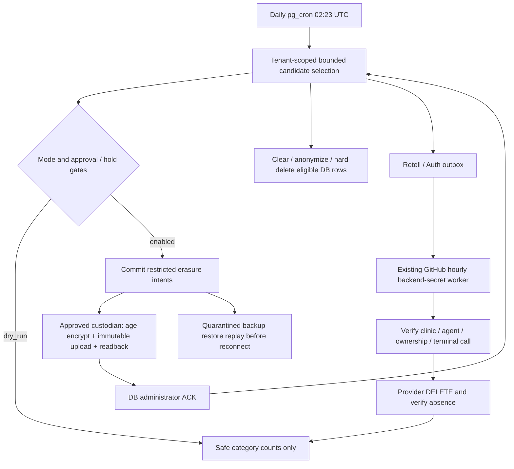

# Apero live-data retention and deletion

Status: **PROPOSED — APPROVAL REQUIRED.** Implemented infrastructure starts in **DRY RUN**. This is a product specification and operational runbook, not a legal document. It does not establish compliance with Kuwait law. Updated 2026-10-06.

Apero is an AI receptionist and scheduling system. The inspected architecture does not establish Apero as Dental Zone's authoritative medical-record system. The clinic must decide which records it needs in its own system before Apero removes operational copies.

## Evidence and boundaries

The input inventory is [patient-data handling](patient-data-handling.md), checked against the current repository, Supabase project `svoybvzvmygszklcmudh`, and read-only Retell agent/call configuration. Local source alone is not evidence that a deployment exists. The deployment and counts-only production assessment are recorded separately in [retention evidence](data-retention-evidence.json).

No existing production/test patient rows or Retell calls were deleted during implementation. No paid call was made. Supabase received additive schema, protective triggers, a daily dry-run job and a backend-only provider worker. No frontend deletion/settings UI was added. WhatsApp is outside launch scope. Final SIP retention is **PENDING PROVIDER SELECTION**.

[Machine-readable policy](../../operations/retention/policy.json) contains the proposed defaults. SQL defaults are tested for exact equality with that file. Durations are elapsed days, evaluated in UTC; expiry means eligible at the next bounded successful run, not guaranteed deletion at the exact second. Holds, active-work protection, provider failure and custody gates can delay expiry and require operator attention.

## Proposed schedule

Every entry below is a **PRODUCT DECISION**. Entries marked **L** also require **LEGAL REVIEW REQUIRED** for applicable Kuwait healthcare/privacy rules, clinic record obligations, contracts, disputes and erasure exceptions. No legal retention minimum is asserted.

| Category / persisted location | Default and clock | Expiry action | Operational reason / exceptions | Review |
|---|---|---|---|---|
| Retell audio/recordings, call trace and provider transcripts, analysis, tool arguments/results | **30 days** after call; configure native agent retention to 30 and reconcile API deletion | **DELETE provider call and associated data**, verify absence | Short quality/support window; no recording-only endpoint verified. Cannot independently retain Retell summaries longer | L |
| Apero full transcripts, AI summaries, title containing speech, caller number, legacy recording URL in `conversations` | **30 days** from `started_at` | **CLEAR CONTENT together**; queue Retell deletion | Summaries contain patient information; same duration as speech. No durable replacement transcript | L |
| Apero minimal call metadata (`conversations` IDs, clinic/client/appointment links, times, duration, status/channel, outcome, unread flag) | **365 days** from call start | **DELETE row** | Reliability/aggregate history; hold while linked future appointment or unresolved Request exists; Retell deletion must be verified first | L |
| Upcoming appointments | Until they become historical and terminal | **RETAIN** | Cleanup never selects `end_time >= now()`, even if status is Cancelled | L |
| Completed / Cancelled / No Show appointments, including appointment notes | **730 days** after the later of appointment end and last update | **DELETE** | Scheduling history/disputes; historical associations use existing FK behavior. Clinic may need separate medical records | L |
| Past appointments still Booked / other nonterminal state | Until clinic reviews and marks terminal; then above rule | **RETAIN, REVIEW** | No silent loss of unhandled work; overdue nonterminal counts require attention | L |
| Patient contact record (`clients` name, phone, email, inline `notes`) | **730 days of inactivity** from latest client edit, appointment, call, note or matched Request activity | **ANONYMIZE contact** (generic name, blank phone, null email/inline notes), preserve UUID | Future appointments and unresolved Requests block action. Preserved activity timestamps prevent shorter-lived row deletion shortening this clock | L |
| Anonymized client shell | **30 days** after anonymization, only once no appointment/call/active-work relationship remains | **DELETE shell** | UUID stays until historical relationships expire; this is pseudonymization while linkable records remain, not guaranteed irreversible anonymization | L |
| Standalone `client_notes` | **365 days** from note creation | **DELETE** | Free text needs a shorter window; retain while patient has future appointment or unresolved Request. Inline client notes follow contact inactivity above; appointment notes follow appointment window | L |
| Failed booking, calendar-unavailable, unknown-answer, human assistance and transfer-failure Requests (`voice_requests`) | **90 days after Closed** | **DELETE** | Open/In Progress/any non-Closed status is never automatically deleted. Reopening resets closure clock; existing Closed rows without verified closure timestamp are held | L |
| Voice idempotency/booking results (`voice_operations`) incl patient name/phone and safe result JSON | **30 days** from creation | **DELETE** | Retry/reliability window; not a permanent patient record | L |
| Transfer, unknown-answer and fallback state (`voice_call_state`) | **30 days** from last update | **DELETE** | Hold if checked-slot rows or unresolved Request for that call still exist | L |
| Checked appointment slots (`voice_checked_slots`) | **1 day after slot expiry** | **DELETE** | Expired rows have no continuing booking authority; active slots remain | Product |
| Free-text notifications (`notifications`) | **30 days** from creation | **DELETE** | Delivery/read window; manual erasure must also review notifications because they have no patient FK | L |
| Operational application/platform logs | **30-day target** from log event | **EXPIRE at hosting/platform provider** | No patient contents in retention logs; actual platform plan/configuration must be verified separately; SQL cannot impose native log expiry | L |
| Security/Auth platform audit logs | **90-day target** from event | **EXPIRE at provider** | Investigation window; provider granularity/control unverified. Not the same as Apero cleanup audit | L |
| Revoked clinic user (`profiles`, associated Supabase Auth user) | **90 days** after `revoked_at` | **HARD DELETE Auth account** through admin API; FK removes profile | Access denied immediately on revocation; deletion does not delete patient/appointment history. Current model has one profile per Auth user | L |
| Invitation attempt/lease records (`clinic_invitation_claims`) | **30 days** after later of attempt/lease expiry | **DELETE** | Bounded anti-retry state, not permanent identity history | Product |
| Active practitioner/staff, working schedule, clinic settings, aliases, integration mapping and credentials | While required by active clinic | **RETAIN**, purge on verified offboarding | Configuration is source of truth for receptionist/scheduling; inactive integrations still need mapping for provider deletion | L |
| Deactivated practitioner contact fields (`staff.phone/email`) | **180 days** after deactivation | **CLEAR CONTACT** | Name/practitioner UUID retained for appointment attribution | L |
| Deactivated practitioner row | **730 days** after deactivation and only after appointment/slot/future-time-off references end | **DELETE** | Prevent broken relationships; existing inactive rows without a verified deactivation clock are held | L |
| Historical `staff_time_off` | **730 days** after end | **DELETE** | Active staff availability remains configuration; past absence does not need indefinite history | L |
| Invitation budget counters (`clinic_invitation_budgets`) | One current bounded counter per scope; retain while scope exists | **RETAIN current state**, delete clinic scope on offboarding | No growing event history; global anti-abuse scope remains operational state | Product |
| Cleanup audit (`retention_runs`) | **365 days** from event | **DELETE audit rows in enabled mode** | Counts, scope, category, success/failure only; dry run does not prune existing records | Product |
| Successful provider deletion receipts/outbox (`retention_provider_jobs`) | **365 days after success**, and only after no corresponding conversation/profile exists | **DELETE receipt** | Retry/ownership evidence until provider and database lifecycle complete. Pending/failed jobs never expire silently | Product |
| Clinic grace period (`clinic_offboarding`) | **30 days** after approved offboarding begins | **PURGE in verified phases**, retain minimal offboarding/deletion enforcement state | No new receptionist processing/access during grace; recovery requires deliberate operator review | L |
| Deletion intents/tombstones and completed offboarding enforcement state | **At least 400 days**, and until every backup capable of resurrection has expired | **RETAIN restricted identifiers**, prune only after verified recovery-point review | No patient speech/contact copy. Automatic pruning deliberately withheld until oldest backup/Supabase recovery horizon is established | L |

Retained open work, holds, relationship shells, configuration and pending deletion jobs are explicit state-based exceptions, not indefinite historical retention defaults. Monitor them and resolve the operational reason. A legal hold is clinic-scoped, blocks new cleanup/provider claims and needs a separately reviewed native-provider setting; an already issued external deletion cannot be undone.

## Categories, source of truth and provider copies

All patient-facing rows are in Supabase PostgreSQL. All original call audio resides with Retell; Apero stores references and normalized speech text, not recording bytes. Supabase Auth is the source of truth for portal identity; `profiles.revoked_at` controls clinic access.

| Tables / category | Source / purpose | Historical necessity and current capability | Independent copy |
|---|---|---|---|
| `clients`, `client_notes` | Staff/voice booking identity and operational notes | Active relationships required; raw direct patient deletion is now guarded. Reviewed operator erasure preserves relational UUID | Spoken/tool-provided data can exist in Retell; no full client-table export verified |
| `appointments` | Apero scheduling DB; staff or signed voice operations | Active future appointments required; cancel is status change. Existing privileged hard delete plus retention RPC | Spoken details, tool arguments/results and retries may remain in Retell/voice operation rows |
| `conversations` | Retell webhooks → normalized call row | Transcript/summary content short-lived; minimal metadata longer. Privileged clearing/deletion supported | Retell independently holds call audio, transcript, analysis and trace |
| `voice_requests` | Booking/calendar/answer/handoff fallbacks | Required until resolved. Closed timestamp now distinguishes work completion from creation | Related speech/analysis at Retell |
| `voice_operations`, `voice_call_state`, `voice_checked_slots` | Reliability, idempotency, transfer and checked availability | Short operational window; internal RPC cleanup, no browser patient export | Provider call trace/tool results |
| `notifications` | Portal operational notification | Short window; privileged row deletion | Platform delivery logs may record metadata |
| `staff`, `staff_availability`, `staff_time_off` | Clinic practitioners, working schedules and absences | Active scheduling source; safely expire historical inactive data | Selected practitioner names/availability spoken or returned to Retell |
| `clinics`, `clinic_service_aliases` | Clinic configuration/services/forwarding | Needed while operating; operator offboarding purges | Retell agent/flow configuration; source/config in GitHub/Lovable can contain clinic configuration |
| `voice_integrations` | Clinic-to-agent routing, secret environment-variable names, transfer configuration | Required for verified provider deletion until offboarding finishes; environment secret values are separate | Retell, deployed Edge secret store, not public dashboard |
| `profiles`, Supabase `auth.*` | Portal identity/membership/sessions/audit | Revocation immediately denies clinic access; admin Auth hard-delete separate from clinic/patient deletion | Supabase Auth; configured account email delivery provider not independently identified |
| `clinic_invitation_claims`, `clinic_invitation_budgets` | Provisioning leases and rate limits | Short-lived claim versus current counter; expire separately | Auth invite/account delivery |
| New retention tables | Scope configuration, aggregate runs, identifiers for deletion/replay, provider queue, activity timestamps | Restricted operational state; no patient speech/contact copy | Encrypted independent deletion ledger once custody is activated |
| Native application/Auth/provider/hosting logs | Provider operational/security telemetry, including new `cron.job_run_details` schedule/status metadata | Provider expiration/configuration, not SQL patient deletion | Supabase, Retell, Lovable/hosting, GitHub workflow metadata |

Retell, Supabase, hosting logs and future backup custody are independent systems. Removing a row is not evidence that every copy disappeared. No currently active additional patient-storage integration was established by the input map. Source repositories must never receive patient records, raw webhook payloads, database dumps or recording links.

## Recordings and Retell

The current published Retell agent is version 16. Read-only configuration reports `data_storage_setting=everything`, signed URLs enabled, expiry **1,060,000 ms (17 minutes 40 seconds)**, post-call PII mode with no configured categories. No `data_storage_retention_days` value was returned; no finite native automatic retention was verified. These settings were **not changed** by this task.

Retell supports `data_storage_retention_days` from **1 to 730**; null/default means indefinite storage. Expired provider call data is removed by its daily lifecycle; some basic internal metadata may remain. This is a provider scope limitation, not an Apero guarantee of zero residual metadata. See [Retell retention controls](https://docs.retellai.com/accounts/data-retention) and [Update Agent](https://docs.retellai.com/api-references/update-agent).

The supported [Delete Call API](https://docs.retellai.com/api-references/delete-call) deletes the call and associated data. No supported audio-only deletion was verified. Therefore provider recording, transcript, summary/analysis and trace have the same proposed 30-day expiry. Apero's independent transcript/summary copies expire separately; Apero minimal metadata may remain to day 365. Expiring a signed URL or clearing `recording_url` does not delete audio. Existing unsigned links also need provider deletion; their absence from a dashboard is not revocation.

After policy approval:

1. Configure and re-read native retention **30 days** on every production Retell agent/version used by a clinic. Publishing or changing agents must preserve this setting. Check implications for existing historical calls before any update; configuration can itself cause deletion and requires approval.
2. Daily Apero selection creates a tenant-scoped call deletion job and restore-prevention intent. No provider DELETE is allowed until intent ciphertext has independent verified custody.
3. Worker resolves the call's recorded agent through exactly one clinic integration, loads its designated server secret, retrieves the call and verifies call/agent ownership and terminal status.
4. Persist a nonsecret credential fingerprint/ownership receipt, then issue authenticated DELETE. Accept 204 and verify GET returns 404. Failure stays pending with bounded backoff; never report deletion success because the dashboard reference was cleared.
5. A retry GET 404 counts as verified absence only with the previous durable ownership receipt for the same credential, or a successful same-credential GET of the exclusively mapped agent (native expiry case). A bare 404 under an unverified credential is not proof of deletion.
6. Provider receipts and counts show the difference between requested, failed and confirmed absent. Calls not represented in Supabase must be caught by native retention and periodic private provider inventory. Offboarding requires a complete paginated agent-call inventory; enroll missing calls through administrator-only `retention_queue_call(clinic, call, agent)` and export/ACK intents before processing. Never paste inventory payloads into Git/logs.

Apero worker network deletion is validated with mocks; no real existing call was deleted to exercise it. A disposable provider call deletion test remains a pre-activation verification if a safe, already existing synthetic call is authorized. Native provider logs/internal metadata and support deletion scope may require Retell support confirmation. The signed playback endpoint continues its existing user/RLS authorization and fetches fresh provider links; an expired/deleted call must fail playback rather than supply a retained copy.

## Transcript and summary lifecycle

At 30 days, clear `conversations.transcript`, `summary`, `caller_phone`, `recording_url`, and patient-derived `title` together. Do not use a summary as an undeclared transcript archive. No full speech text is written to the deletion ledger/audit. Durable tombstone-aware webhook triggers prevent these fields being repopulated by late updates and suppress resurrection of deleted call rows.

Requests and appointment/client notes can independently contain patient details supplied during a call. They are separate operational records with explicit schedules, not asserted to be anonymous. An Open Request remains until handled; closed content expires at 90 days. Manual patient erasure reviews and removes matched closed Requests and voice operation results, clears historical appointment notes and removes standalone client notes. Ambiguous shared phone numbers require review; no raw phone-only mass erasure is offered.

## Patient and appointment deletion

There is no direct patient self-service deletion. Clinic staff route a verified request to an authorized Apero operator. Roles do not gain new retention RPC authority; database administrator access is required for explicit erasure/offboarding/ledger acknowledgement.

- **Future appointment or unresolved work:** preserve patient relationships and contact; return a safe blocked reason. Arrange cancellation, rescheduling, handover or a documented exception before erasure. Cleanup never deletes a future appointment.
- **Historical-only patient:** remove contact identifiers, notes and linked call contents first. Keep relational UUID for historical appointment integrity. Appointment treatment/timing may still be sensitive; pseudonymization is not a claim of legal anonymity.
- **Staff direct deletion:** new DB guard prevents deleting active patients and requires historical patient contact erasure before hard deletion. Existing dashboard has no patient-delete flow; direct Owner/Manager DELETE is no longer a shortcut around the lifecycle.
- **Clinic/patient request:** verify tenant and identity, review duplicate/shared contacts and unlinked notifications/Requests, check holds/medical-record obligations, then use reviewed operator procedure below. Do not grant an employee service-role access to bypass it.
- **Appointment cancellation:** retains the record. Only terminal, past, expired rows are selected for automatic hard deletion. Failed bookings are Requests/operations, not valid appointments to fabricate or retain for 730 days.

### Manual erasure procedure (not enabled in production)

1. Privately verify clinic/patient UUIDs and scope; check legal hold and all future appointments/Open Requests, shared contacts, unstructured notifications and unlinked records. Do not log matching values.
2. Administrator calls `retention_erase_client(clinic_uuid, client_uuid, true)` for a counts-only preview. It refuses another clinic's patient and active work. More than 500 matched calls requires staged review.
3. After explicit policy/request authorization, first `false` invocation prepares identifiers and returns `awaiting_durable_ledger`. Export through the encrypted custody procedure; ACK only verified uploaded intents.
4. Re-run to remove contact/content and queue provider work. Provider intents created by this step need their own verified export before a worker can claim them. Retained UUID relationships stay valid.
5. Verify database masks, provider confirmed-absence receipts, safe category counts, and any manually reviewed unstructured copies. Report pending/failed/provider log limitations honestly. Backup disappearance follows the separate policy; record any legally required exception with counsel.

Direct SQL performed outside the lifecycle can bypass audit/restore guarantees; restrict DB-admin access and require reviewed procedures. Manual changes involving notifications/unlinked matching require explicit tombstone preparation, durable custody and scoped deletion; do not assume patient FK cascades cover them.

## Membership, Auth and clinic offboarding

Revoking access sets `profiles.revoked_at`; existing RLS membership resolution denies that user immediately. It is distinct from disabling/banning the Auth account, hard deleting Auth, deleting a clinic, or deleting patient data. Existing sessions may remain technically valid Auth identities but cannot access clinic data. An Auth ban/session invalidation is a separately reviewed operator action.

After 90 revoked days, queue Auth hard deletion. Verify UUID, same-clinic revoked profile, Auth ownership/existence and deletion outcome. Removing Auth/profile records leaves patient and appointment records intact; authored note links can become null and profile-targeted notifications cascade. Soft Auth deletion is not used. The current one-profile-per-Auth-user model must be revisited before introducing multi-clinic memberships.

Clinic offboarding is operator-only, never invoked automatically merely because a bill is late:

1. **Disable processing and access:** `retention_begin_offboarding(clinic)` disables voice integrations and revokes clinic memberships. Stop inbound/outbound routing, Retell processing and carrier legs explicitly, disconnect calendar/other actual integrations, invalidate sessions where needed. Database disable is not proof the telephone carrier has stopped; record `telephony_stopped_verified` only after verification. No such action was run on production.
2. **30-day grace:** preserve disabled data for deliberate recovery/export. Retell's proposed 30-day call lifecycle still applies; grace does not promise restoration of expired audio. Recovery requires reviewed access/routing reactivation, not an automatic toggle.
3. **Purge:** after grace and legal/contract review, verify the complete provider inventory and hand over/cancel active appointments and Open Requests. Normal purge blocks active work. A separately verified `active_work_handover_verified` exception permits complete clinic closure after that work has been moved; daily cleanup never uses this exception. Persist/encrypt/ACK clinic-offboarding intent, queue Retell/Auth copies in bounded batches, wait for verified provider deletion, then delete clinic-scoped DB rows in FK order (one table per call). Revoke environment/provider credentials, remove or archive patient-free agent/flow configuration deliberately, and set `secrets_revoked_verified`. Only then remove integration/settings/clinic row and mark complete.
4. **Backup expiry:** live data is gone; historical encrypted backups age out unchanged. Preserve independently held offboarding/deletion identifiers and reconcile any restoration before reconnecting anything.

Readiness flags are administrator attestations, not proof generated by the carrier. Record the actual private verification outside patient-content logs. Sensitive profile-update triggers require authenticated service-role context for owner revocation; approved SQL-admin sessions must set transaction-local `request.jwt.claims` to `{"role":"service_role"}` for those operations, and must never change persistent session/system settings. Browser and backend service-role users cannot execute offboarding/erasure/ACK/replay RPCs.

## Supabase and other provider deletion

Supabase PostgreSQL supports scoped hard deletion and nulling fields; RLS bypass still requires SQL privileges. New fixed-scope SECURITY DEFINER functions have fixed search paths, whitelisted tables and no browser EXECUTE. All retention tables have RLS and no anonymous/authenticated access; backend receives only necessary read/RPC authority. No Supabase Storage bucket or patient recording bytes were found, so no storage-object purge is invented.

Auth deletion uses the supported Supabase admin API. Native logs, platform backups/PITR and administrative copies do not disappear merely because SQL/Auth deletion succeeds; verify actual plan and provider deletion scope. Do not promise immediate physical erasure from platform replicas/backups. Lovable/hosting and GitHub operational logs must have their actual lifetime/access configuration confirmed against the targets; this code does not configure them. Existing GitHub is reused for provider reconciliation, not a new vendor. Future AWS receives only encrypted deletion identifiers once provisioned; no current upload is claimed.

Final SIP carrier may have CDRs, caller/recipient numbers, recordings, voicemail, transcripts, metadata or transfer leg copies. Retention, region, delete API, hard-delete scope, logs/support access, backup expiry and offboarding disconnection are all **PENDING PROVIDER SELECTION**. It must be resolved before describing end-to-end erasure as complete.

## Backups and restore reconciliation

Use the existing [backup architecture](backups-and-recovery.md) and [AWS setup](aws-github-backup-setup.md). Its schedule and backup-retention policy are **unchanged**. Independent AWS backup/custody is not yet verified operational; do not infer it from code.

Deleting live data does not immediately remove rows from historical encrypted snapshots. Do not edit individual snapshots to remove a row unless a verified technical/legal obligation requires it. They expire under the separate backup policy. Supabase-native recovery horizons also need verification.

A deletion ledger inside a restored old DB would itself be old. Therefore an erasure intent is committed first, encrypted and uploaded/read-back verified into **independent custody**, and only acknowledged intents can authorize subsequent mutation/provider deletion. This prevents live erasure from outrunning its restore-prevention record. A failed upload never ACKs. The DB administrator alone can ACK; the normal worker/service key cannot forge custody.

`export-ledger.py` exports up to 10,000 unacknowledged identifier-only intents per invocation into private age ciphertext. Each immutable object is a cumulative **batch**, not a complete ledger snapshot: retain and merge the union of all unexpired ledger batches during recovery, de-duplicating intent UUIDs. It uses the existing private Bahrain S3 adapter, checksum readback, encryption recipients and Object Lock, with a **400-day lock for deletion-ledger objects only**. This does not change database-backup retention or its jobs. A dedicated approved custodian/runner must run and monitor export between preparation and cleanup. The exporter uses a read-only extraction transaction and a separate TLS-verified administrator connection named by `RETENTION_ACK_SERVICE` in a private `PGSERVICEFILE` for parameterized UUID acknowledgement; the normal worker and extraction-only role cannot ACK. The management query endpoint was read-only during this deployment, so it is not used for custody acknowledgements; no custody schedule has been activated while destination/key custody remains unverified.

Restore steps:

1. Restore into quarantined infrastructure with routing, memberships and cron disabled. Never restore straight over a connected production service.
2. Obtain all current independently encrypted ledger batches/outbox verification evidence after the snapshot, verify/decrypt in the restricted recovery environment, merge intent rows by UUID and unique resource scope. Only verified ciphertext imports may be marked durable.
3. Run administrator-only `retention_replay_ledger(clinic)` for each affected clinic. It masks call/contact/note content, deletes scoped resources, disables offboarded clinic routing/access and re-queues Auth deletions. Restored active appointments or Open Requests conflicting with a deletion require manual quarantine review; do not silently delete active work to make reconciliation pass.
4. Reconcile provider receipts against live provider absence. A restore must not restore expired audio/reference access or resurrect deleted users. Re-run offboarding purge as necessary; offboard replay deliberately keeps it disabled until that review completes.
5. Check safe counts/protected rows, then recreate exactly the fixed SQL schedule from `operations/retention/schedule.sql` in approved mode. Reconnect only after restore/replay review.

Tombstones contain resource UUIDs/call IDs and actions, so they remain restricted sensitive operational identifiers, **not anonymous audit logs**. Minimum retention is 400 days plus the verified oldest recoverable backup horizon and restore grace. No automatic tombstone/offboarding-state prune is enabled while that horizon is unknown; an administrator must verify that no unexpired snapshot can resurrect the target before pruning. Prepared intents can be replayed conservatively even if a live operation was interrupted.

The backup preflight previously rejected all `pg_cron`. It now permits **only** the single fixed SQL-only retention job and documents source-controlled schedule recovery; arbitrary cron/HTTP jobs remain rejected. No `pg_net`, Vault secret or new backup schema export is introduced.

## Automated architecture and configuration



Daily scheduling uses existing [Supabase Cron](https://supabase.com/docs/guides/cron), **02:23 UTC / 05:23 Kuwait**. Each transaction selects one clinic, acquires a clinic advisory lock and processes at most **100 records per category**; scope can never come from patient content. At most 100 eligible clinics per daily invocation, oldest last-run first; review/sizing is required as tenant volume grows. Server RPC batch max is 500. Exact row lock and eligibility recheck protect concurrent state changes. Category subtransactions roll back on failure without breaking FK integrity; independently successful categories can complete. Errors store only `database_error`, `provider_error`, or `configuration_error`.

Provider reconciliation runs hourly at minute 40 only if GitHub variable `RETENTION_PROVIDER_ENABLED=true`, with an approved `production-retention` environment, backend key and explicit tenant UUID list. Each worker call claims at most two provider jobs using SKIP LOCKED/5-minute leases and tenant guards; failed operations retry up to a 24-hour backoff. No provider deletion is allowed in dry-run/disabled mode. Lease and ownership receipt checks recover from an external DELETE followed by a failed DB acknowledgement. Two claims per hour impose a bounded throughput; monitor backlog and adjust approved frequency/capacity before volume outgrows it.

Initially use **one Apero default** for Dental Zone. `clinic_retention.overrides` supports validated future per-clinic durations without redesigning job selection; no settings UI. Configuration is administrator-only, whitelisted 1–3650 integer days. Retell native retention only accepts 1–730 and must be reconciled separately when an override changes. Overrides cannot remove future-appointment/Open-Request protection. Global control defaults to `dry_run`; database CHECK requires both `approved_at` and `restore_ledger_ready` before `enabled`.

New clocks do not rewrite existing patient rows. Existing Closed/inactive records with unknown closure/deactivation dates remain excluded until a clinic-verified transition/touch supplies a timestamp; do not guess dates from creation time. Contact inactivity uses derived source clocks plus a restricted last-activity timestamp preserved when call/Request/note rows expire.

## Monitoring and logging

`retention_runs` stores run UUID, timestamp, clinic UUID, category, mode, count, success/failure and safe failure class. It never stores patient name/phone, transcript, summary, URLs, tokens, provider payloads or raw exception messages. Individual category receipt UUIDs accompany an overall run UUID; do not treat them as patient identifiers. The provider worker logs only equivalent safe operational fields. Outbox/ledger contain only restricted necessary resource/ownership identifiers; they are not application logs.

Operators must check daily overall-run freshness (alert/review if no success within **36 hours** for an active clinic), category failures, pending provider jobs older than **24 hours**, repeat provider failures, unacknowledged intents/custody failures, old nonterminal appointments, unresolved Requests and held categories. These are runbook thresholds; no outbound alert integration was activated by this task. Existing production monitoring remains unchanged. Configure platform-native log lifetimes (including fixed SQL-only pg_cron execution metadata) and verify log access before claiming the 30/90-day targets are enforced. Cron execution records contain the fixed command and run status; automatic cron-history pruning has not been enabled by this task.

Never log passwords, access/refresh tokens, API/service-role/Retell keys, authorization headers, encryption private keys/passphrases, full transcripts, summaries, recording URLs, full webhook/raw provider bodies or unnecessary patient phone/name. New tests include sensitive sentinel strings and verify absence from audit/log-facing responses. Platform-native HTTP identifiers and management SQL metadata remain separate access-controlled provider logs.

Counts-only review can use administrator SQL, for example (the restricted `retention_candidates` functions are intentionally unavailable to the read-only management role; that role can inspect completed dry-run audit counts):

```sql
select category, count(*) from public.retention_candidates group by category order by category;
select mode, approved_at, restore_ledger_ready from public.retention_control;
select category, state, sum(processed) from public.retention_runs
where started_at > now() - interval '2 days' group by category, state;
```

Do not dump candidates, ledger identifiers, request bodies or provider inventories into public evidence.

## Production assessment and tests

See [evidence](data-retention-evidence.json) for timestamped counts, migration hashes, protected-row counts and mode. Production counts: **8 clients, 11 appointments, 29 conversations, 0 Requests, 1 voice operation, 88 checked slots and 6 call-state rows**. Proposed eligibility: **88 expired checked slots; every other implemented category 0**. There are **0 future appointments, 0 unresolved Requests and 10 past Booked appointments** held for review. Both provider outbox and deletion-intent counts remain **0**. The initial bounded audit is below its 100-per-category limit and accounts for all 88 slot rows. Counts are a snapshot, not permission to delete. Dry run creates safe audit rows only; it neither creates deletion jobs/intents nor clears existing patient rows. Retell read-only inventory is 30 calls, all younger than 30 days at inspection, with recording references on all 30; zero provider calls are age-eligible under the proposed window.

Tests use synthetic isolated PostgreSQL (PGlite), two tenants and mocked provider/custody operations. They cover future appointment/recent call protection, speech and duplicate title/summary/URL removal, Request closure/reopening/expiry, contact relationship integrity, foreign-clinic/browser denial, batching, idempotency, holds, leases, upload-before-ACK, retry after provider/DB failure, safe audits and bounded offboarding/restore isolation. Edge bundling and workflow lint are checked. No destructive test uses production data. **32 Node tests, 4 custody tests and 22 existing backup tests passed**; Edge bundle and Actions workflow lint passed. The unauthenticated deployed worker returned **401**. Exact results are recorded with the deployment evidence.

## Approval and activation checklist

Before any destructive production action:

1. Approve the proposed schedule, including equal 30-day transcript/summary/provider windows, 730-day appointment/contact rules, note exceptions, 90-day closed Requests/accounts and 30-day offboarding grace. Have counsel/clinic confirm legal/contract/medical-record obligations and erasure exceptions.
2. Verify separate backup/ledger infrastructure, encryption-key custody, Object Lock, upload/readback and quarantined restore/replay. Assign an approved custodian and predictable export run; establish the oldest Supabase/independent recovery horizon. Keep `restore_ledger_ready=false` until this works.
3. Re-read fresh counts-only dry run; review old Booked/Open/inactive-with-no-clock and unsigned recording cases, then authorize the initial eligible scope. No bulk current/test deletion is implied.
4. Validate safe disposable Retell/Auth deletion, native Retell automatic retention and all agent versions; check provider residual metadata and hold behavior. Setting native 30 days can affect pre-existing calls, so requires explicit approval.
5. Configure restricted GitHub worker key/tenant allowlist/environment, actual native log lifetime/access, backlog/failure monitoring and custody scheduling. Verify SIP provider deletion/retention/disconnection before production connection.
6. DB administrator records approval and enables the control only after verified custody; enable provider reconciliation and native provider retention deliberately. Activation SQL is intentionally not included as an executable automatic step.

**Define data retention is not yet COMPLETE:** the proposal, safe mechanisms and synthetic validation are ready for review; destructive mode/native provider expiry remain disabled. Approval, legal/clinic decisions, actual custody/restore verification, provider deletion verification, native-log configuration and SIP selection are outstanding. Do not label a dry-run implementation as enforced end-to-end production retention.
