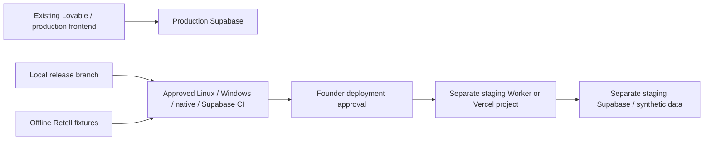

# Isolated staging recommendation and cost decision

Prepared November 20, 2026. No hosted account, project, branch, deployment or paid service was created. These are researched list prices and conditional planning estimates, not a quote against Apero's actual accounts.

## Recommended architecture

Use a **separate Supabase staging project**, synthetic data and a separate staging frontend deployment. Keep the current Lovable-connected project and its active branch/backend unchanged. Cloudflare Workers is the closest initial hosting fit because this repository already builds a Nitro Cloudflare server bundle. Vercel is an alternative after separately validating the appropriate Nitro deployment target; a static-only Pages deployment is not established for this server-rendered application.

The diagram describes the proposed separation, not provisioned infrastructure. No stage-to-production database or provider connection is needed.

The repository currently names one Supabase project. An isolated hosted staging environment, account plan, unused Free slot, existing Workers subscription and Lovable active branch have **not** been verified. Reusing the existing frontend project or merely switching Git branches does not establish database isolation. Lovable syncs the active branch configured in its Git settings; confirm it before any approved push or integration change. [Lovable Git sync documentation](https://docs.lovable.dev/integrations/github).

### Accounts and services

- Existing GitHub repository and Supabase organization may be reused for administration, with a separate staging database/project and credentials. No second organization is required unless the founder chooses administrative separation or an eligible Free organization.
- A Cloudflare account and a distinct Worker project are required if not already available. A vendor-provided staging hostname avoids buying a domain. Use restricted project/account access and an explicit approved deploy identity.
- No additional Lovable account or editor project is required for an independently hosted staging frontend. Repointing or cloning the connected Lovable project is a separate decision; do not change the production editor connection as a staging shortcut.
- Vercel would require a separate project and an appropriate commercial plan/seat. Its Hobby plan is limited to personal/non-commercial use; do not budget clinic staging as Hobby without resolving plan eligibility. [Vercel terms](https://vercel.com/legal/terms).
- No Retell staging account, phone number, paid simulation, mail subscription or AWS recovery resources are required for the initial mocked/synthetic validation phase.

## Cost options (USD, before taxes, FX and usage overages)

| Item | Published price / constraint | Conditional staging impact |
|---|---|---|
| Supabase Free | $0; two active Free projects; inactive projects can pause; 500 MB database | $0 only if an eligible slot is actually available. Suitable for synthetic, intermittent acceptance; account eligibility is unknown. [Pricing](https://supabase.com/pricing). |
| Extra Supabase Micro in an existing paid organization | About $10/month; paid plans have $10/month organization compute credits | Estimate **+$10/month** if production already consumes the credit. Existing credits are not assumed available. [Compute billing](https://supabase.com/docs/guides/platform/manage-your-usage/compute). |
| New dedicated Supabase Pro organization | From $25/month, with one Micro covered by the included compute credit | Estimate **$25/month** for staging on a new paid organization, plus overages. This is an alternative, not an extra fee on top of the prior row. [Pricing](https://supabase.com/pricing). |
| Supabase preview branch alternative | Micro starts at $0.01344/hour; branch usage is billable and not covered by compute credits/spend cap | Approximately **$9.81 for 730 hours**, or **$0.40 for 30 hours**, before other usage. Prefer an independently named persistent staging project unless branching ownership/lifecycle is explicitly chosen. [Branch billing](https://supabase.com/docs/guides/platform/manage-your-usage/branching). |
| Cloudflare Workers | Free limits include 100,000 requests/day and 10 ms CPU/invocation; Paid has a $5/month account minimum | $0 only after confirming this SSR workload fits Free limits; otherwise budget **+$5/month** if the account is not already Paid, plus usage. [Worker pricing](https://developers.cloudflare.com/workers/platform/pricing/). |
| Vercel Pro alternative | $20/month per seat, plus usage | Budget **+$20/month for one new paid seat**, unless already covered by the account. Requires a separate adapter/deployment smoke test. [Vercel pricing](https://vercel.com/pricing). |
| GitHub Actions | Published baseline rates: Linux 2-core $0.006/min and Windows 2-core $0.010/min after applicable allowances | Estimated **$0.15–$1 per full run** for planning; this is not measured remote runtime. Included minutes or repository eligibility may change the charge. Actual runner SKU must be checked. [Runner prices](https://docs.github.com/en/billing/reference/actions-runner-pricing), [billing](https://docs.github.com/en/billing/concepts/product-billing/github-actions). |

**Recommended planning allowance:** an additional Micro project in the existing paid organization plus a new Paid Workers account is roughly **+$15/month plus usage and CI**. A new dedicated Pro organization plus Workers is roughly **$30/month plus usage and CI**. A Free-project/Free-Worker experiment may be $0 in provider subscriptions only if both eligibility and workload limits are verified. Vercel replaces Workers in these totals; it is not required alongside it.

No one-time service setup fee is included in the estimate for standard vendor-hosted URLs. Custom domains, SMTP sinks, support, data transfer, backup add-ons, premium compliance features, labor and any existing plan charges are not estimated here. Verify the account billing dashboard and set approved limits before provisioning. No cost is assumed free because it is automated. This session spent **$0**.

## Environment and credential separation

| Scope | Setting | Staging rule |
|---|---|---|
| Browser build | `VITE_SUPABASE_URL`, `VITE_SUPABASE_PUBLISHABLE_KEY` | Only the new staging project; keys are publishable, never secret/service-role values. |
| SSR public configuration | `SUPABASE_URL`, `SUPABASE_PUBLISHABLE_KEY` | Match staging; separate host/project-scoped values. |
| Optional future SSR admin consumers | `SUPABASE_SERVICE_ROLE_KEY` | Omit from the frontend host unless a reviewed server-only consumer needs it. The current source contains a lazy admin client but no importing runtime consumer was found. Never expose through VITE variables. |
| Supabase Edge runtime | platform-provided `SUPABASE_URL`, `SUPABASE_ANON_KEY`, `SUPABASE_SERVICE_ROLE_KEY`, modern `SUPABASE_SECRET_KEY(S)` where used | Staging runtime only. Never copy production values or place them in GitHub test jobs. |
| Edge origin checks | `APERO_PORTAL_ORIGIN` | Exact approved staging HTTPS origin; configure staging Auth site/redirect URLs correspondingly. |
| Demo | `APERO_DEMO_ENABLED=false` | Keep real demo creation disabled. No production agent mapping, API key or phone number. |
| Retell configuration | `voice_integrations`, `RETELL_*` secret mappings | No active production mapping or key. Empty/inactive staging mappings fail closed; mocks remain in test harnesses. |
| Retention | `retention_control`, legal holds, provider job execution | Keep dry-run; do not activate provider workers, schedulers that call paid services, or external backup executors as part of staging setup. |
| Notifications/email | Auth SMTP, invitation/reset handlers | No real recipient traffic. Hosted management handlers that send invitations stay undeployed or inaccessible until a non-delivering test sink and allowlisted synthetic users are approved. Local SDK/handler tests already mock these calls. |
| CI | build placeholders, local fixture credentials | No hosted Supabase, Retell, AWS or mail secrets are required by the release checks. |

Use a separate staging hostname and Supabase Auth project so browser sessions and tokens do not share production storage or redirect destinations. Disable public signup and third-party Auth providers unless explicitly needed for a reviewed test. Create only synthetic users, confirmed without sending email through a reviewed staging-only provisioning path; do not import production Auth rows, clients, transcripts, recordings or backups.

Cloudflare/Vercel deployment credentials, when later approved, belong in a protected **staging** GitHub environment or the host's secret store, with no production authority. There is no deployment workflow in this candidate.

## Migration and acceptance procedure

1. Pass all five CI jobs, including actual Windows and Docker-backed Supabase checks, before hosted acceptance. Native PostgreSQL 16.15 evidence does not certify a different managed version.
2. After budget and environment approval, create an empty, separately identified staging project. Record its ref/URL and verify they differ from production before any write.
3. Apply the full **22-file** ordered chain for a fresh project, including the schema-only baseline and all older prerequisites. The nine specially prepared files and their dependency/recovery rules are listed in [migration-rollout.md](migration-rollout.md) and [checksums](migration-checksums.json).
4. For any existing staging database, inspect version history/schema/owners/ACLs first. Never execute the fresh baseline on an established database or mark a version applied blindly. Any history repair is a separately approved write.
5. Seed two synthetic clinics and owner/manager/staff users; check cross-clinic denial, request handling, account revocation, note retention, appointment conflicts/practitioner eligibility, holds and offboarding with provider steps mocked. Confirm actual extension locations and cron execution, while retention stays dry-run.
6. Deploy approved Edge handlers only after required RPCs exist. Deploy the staging frontend against staging environment variables, then verify auth refresh/revocation, form preservation, recording error/reload behavior and navigation.
7. Retell contract tests use the committed mock transports, offline flow configuration and synthetic SQL fixtures. They never execute a live agent. No webhook is pointed at production, no phone is attached, and no real SDK call is started. Audio/provider end-to-end testing is outside this approval and needs its own cost/recipient authorization.

## Failed-release recovery

Keep production unchanged while staging is evaluated. Record the candidate commit, lockfile and migrations applied. Rebuild or redeploy the previous approved staging frontend/Edge version if needed; do not reset or rewrite published history. Retain additive RPCs/indexes while rolling back their consumers. Keep legal holds, nullable historical authors and deletion ledgers intact.

Stop on a failed migration transaction; inspect recorded versions before continuing. Prefer an additive corrective migration. Destruction/recreation of a synthetic staging project, restoring any real backup, or touching production requires explicit approval. A successful frontend rollback does not roll back a database purge. Leave provider deletion and retention enablement out of deployment.
